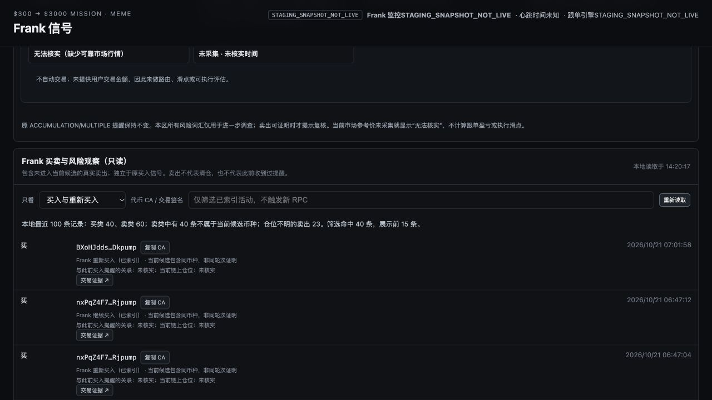
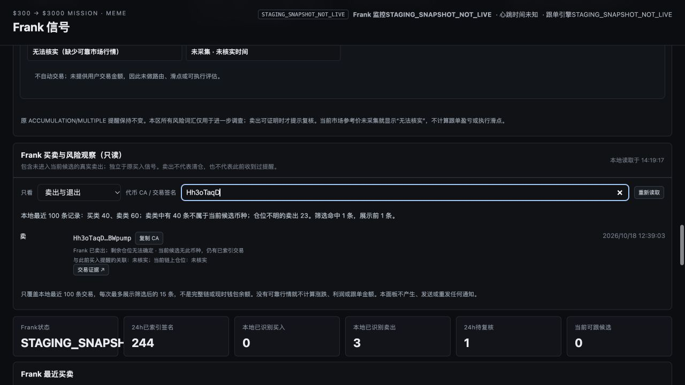

# PR #157 Mac 隔离集成验收 — PASS

执行日期：2026-10-22。真实 macOS + Codex in-app browser 页面交互。此为固定快照的功能/可用性验收，不是生产安装、完整链上覆盖或收益证明。

## 版本和实际差异

- 产品运行代码：`31dd598df248ca15f731913a5cbf82e88b981874`。
- 基线 PR #146：`72cf75c61fdb220a01b98df0abe81ebc5d248fd4`。
- 实际隔离 checkout / 运行 QA SHA：`7d4143d0233758cfb3776d5f35b86e53e9eb749e`。
- 开始时 PR #157 远端为 OPEN / Draft、HEAD 等于上述产品 SHA；QA 远端分支等于上述 QA SHA。
- QA 相对产品只新增 `.github/workflows/frank-pr157-isolated-stage-qa-20261020.yml` 和 `crypto-300-profit-mission/local-agent/scripts/frank_pr157_mac_integrated_staging.py`。
- 本轮没有修改产品或 QA 脚本。独立证据分支仅新增本目录报告、脱敏交互 JSON、截图和校验和；证据提交不是新的产品运行 SHA。原源码 APPROVE 仍仅对应原产品 SHA。

## 实际执行

在独立临时 checkout 中执行，未切换主仓库分支，未安装依赖：

```sh
python3 -B crypto-300-profit-mission/local-agent/scripts/frank_pr157_mac_integrated_staging.py --preflight
python3 -B crypto-300-profit-mission/local-agent/scripts/frank_pr157_mac_integrated_staging.py
# 以下在 crypto-300-profit-mission/local-agent 中，使用已有 Python pytest 环境
python -B -m pytest -q -p no:cacheprovider tests/test_frank_activity_watch_dashboard.py tests/test_frank_amount_free_intelligence.py tests/test_frank_amount_free_preview.py tests/test_frank_intelligence_dashboard_integration.py
node --check mission_agent/mission_control/static/app.js
```

实际 pytest 使用已有 `/private/tmp/pr108venv/bin/python`：**47 passed in 0.11s**。JavaScript 语法检查退出码 0。预检与启动均实际执行，终端关键输出：

```text
PR157_STAGING_PINNED_SOURCE_OFFLINE_PREFLIGHT: PASS
PINNED_REVIEWED_PRODUCT_SHA: 31dd598df248ca15f731913a5cbf82e88b981874
SOURCE_CAPTURED_AT_UNIX: 1792653481.374
PR157_STAGED_PRODUCT_GET_AND_UI_SMOKE: PASS
PRODUCTION_MODIFICATIONS: 0
REAL_NOTIFICATIONS_SENT: 0
```

实际 `REAL_PRODUCT_ACTIVITY_EVIDENCE` 的脱敏数值：source=`OLDER_FRANK_8766_ONE_SHOT_GET_NOT_LIVE`；source_runtime_at_capture=`LIVE`；source_scope=`LOCAL_INDEX_ONLY`；chain_completeness_verified=false；source_candidates=7；source_recent_rows=100；source_unique_signatures=100；source_distinct_mints=43；activity_displayed_transactions=100；excluded={}。

| 分母：最近最多 100 条本地已索引交易 | 实测数 |
|---|---:|
| 买入类 BUY + ADD + REENTRY | 40 |
| 卖出类 SELL + EXIT + SELL_POSITION_UNRESOLVED | 60 |
| BUY / ADD / REENTRY | 21 / 14 / 5 |
| SELL / EXIT / SELL_POSITION_UNRESOLVED | 8 / 29 / 23 |
| 卖出类中不在当前 7 个候选 Mint 集合 | 40 |

以上来自此次快照，不能硬编码，也不能与旧 41/59/25 或 46–48 条候选外卖出混用。100 为统计窗口，页面每次最多展示 15 条；不是链上完整历史。候选外卖出 40 条全部保留在该窗口的活动 API/筛选集合中，不代表同时展示 40 行。

## 真实页面结果

访问 `http://127.0.0.1:18766/`，实际操作和截图如下。交互汇总见 [browser-checks.json](browser-checks.json)。

| 操作 | 结果 |
|---|---|
| 默认卖出、退出 | PASS：命中 60，渲染 15 |
| 仓位不明卖出筛选 | PASS：命中 23，渲染 15，所有行明确剩余仓位无法确定 |
| 买入及重新买入 | PASS：命中 40，渲染 15，可见重新买入标签 |
| 全部买卖 | PASS：命中 100，渲染 15，同时包含买卖 |
| 完整真实 CA 搜索 | PASS：精确命中 1 条候选外卖出；复制目标与完整 CA 相同。公开截图仅保留 8 字符搜索前缀 |
| CA 复制 | PASS：实际点击，剪贴板内容精确相同，按钮显示已复制；恢复原剪贴板 |
| Solscan 链接 | PASS：默认 15 行均为 https://solscan.io/tx/ + 64–88 字符 base58 签名，target=_blank，rel 包含 noreferrer；未访问外部交易页面 |
| 候选外卖出 | PASS：页面明确提示当前候选无此币种，仍有已索引交易 |
| 统计和风险语义 | PASS：最近 100 与展示 15 明确区分；EXIT 明示本地标记退出、当前余额未核实；未宣称链上已证实清仓 |
| 金额、价格和通知 | PASS：目标活动面板无默认买入金额、虚构收益或市场价格；无真实通知发送 |
| 清空搜索和本地刷新 | PASS：快照统计仍为 100 / 40 / 60 / 40 / 23 |





没有发现 P0/P1/P2 或阻断正常使用的问题，不需要修复。未为 P3 视觉/措辞做产品改动。实际浏览器覆盖为 Mac in-app browser；不声称 Safari/Chrome 全矩阵或生产安装已验收。

## 隔离与清理

- 隔离工具对正式 8766 的各快照源执行一次性 GET；后续页面请求只读内存快照，没有持续转发到生产。
- 使用产品真实 DashboardState.frank_activity_watch()、Handler.do_GET() 和已审核静态资源。HTML 的隔离提示及 CA 提交禁用由隔离工具在内存注入。
- 未直接连接生产 SQLite；对隔离 PID 的打开文件检查未发现 SQLite/DB 文件。未转发 POST；不安全 GET 被拒绝、POST 被拒绝，均由工具 smoke 实测。
- 未进行 RPC、报价、Gmail、系统通知、交易、launchctl、生产安装、合并或部署；未触碰 8765。
- 正式 8766 根页面在测试前后 GET HTTP 200；PID 始终 35963，启动时间始终 Tue Oct 13 17:32:07 2026。未停止或重启该进程。
- 关闭本次浏览器测试页，只向本次隔离 PID 60545 发送 SIGINT。实际输出 `PR157_STAGING_STOP_REQUESTED`，进程退出码 0，18766 随后关闭。
- 主仓库 HEAD 仍为 b4404d6084270114950d6c90175ca7682cf8e356，已有修改和其他任务文件未改动。
- 公开证据不包含原始生产快照、数据库、完整钱包/CA/交易签名、凭据或生产私有路径。

## 结论

**PASS：Frank 买卖与风险观察已通过真实 Mac 隔离功能与可用性验收，可以进入下一阶段生产切换决策。** 候选外卖出未被候选集合过滤丢失。本阶段应结束，不继续重复同一历史样本。本结论不授权合并、部署或生产服务操作；生产切换等待用户单独授权。
