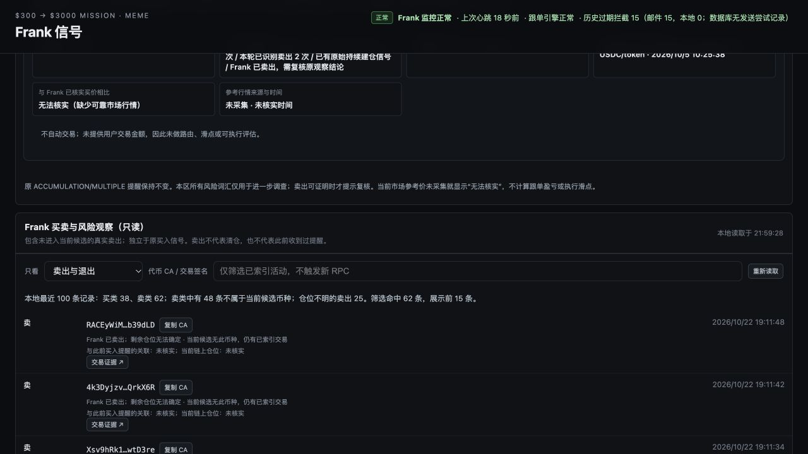
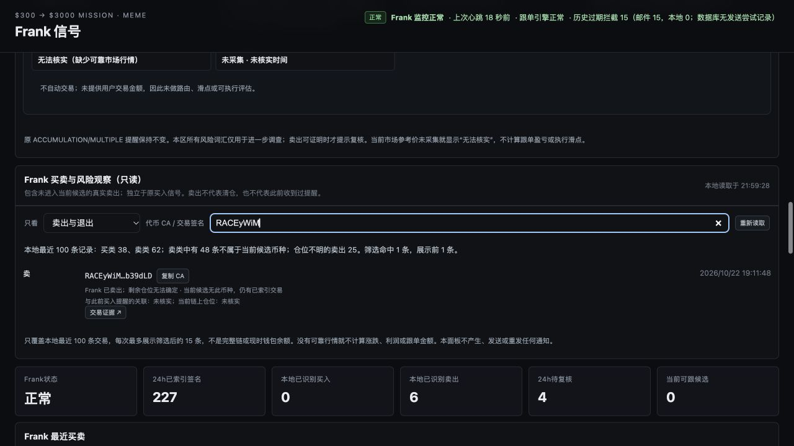

# Frank PR #157 — PRODUCTION_DASHBOARD_PASS

Execution date/time: 2026-10-22, Asia/Bangkok (+07:00). This report records the **actual authorized Mac production cutover at 127.0.0.1:8766**, not the previous temporary rehearsal.

Authorization: [owner scope recorded on PR157](https://github.com/lxxlx2/ChatGPT_mission_record/pull/157#issuecomment-6342016924), plus direct instruction in the execution chat. Fixed [decision and safeguards](https://github.com/lxxlx2/ChatGPT_mission_record/blob/b44493e4e3520504ac929703f7dd689e5a05cc91/docs/MONITORING/frank-release-20261022/mac-release-readiness/DECISION.md), full rehearsal and both independent reviews read in full before acting. No PR merge performed.

## Versions and package identity

| Role | Exact identity |
|---|---|
| Installed NEW Dashboard product | `31dd598df248ca15f731913a5cbf82e88b981874` |
| OLD shared release, retained untouched for Loop and rollback | `52d43d18ee5a6d87408bc68d4832869fce8817a9` |
| Prior fixed readiness evidence | `b44493e4e3520504ac929703f7dd689e5a05cc91` |
| Candidate files | **435**, entire fixed-SHA local-agent Git archive |
| Canonical filename-to-SHA256 manifest digest | `568c02201905377e83c4fd126ecb37fa02c6baa6f672b6ab62a40c80d155ff5a` |

The digest is SHA256 of `json.dumps(manifest, sort_keys=True).encode()`, not tar bytes. All 435 files rehashed after launch, no additional file drift. New dedicated installed directory relative to FrankMeme support root: `dashboard-only-releases/31dd598df248ca15f731913a5cbf82e88b981874`. Directories/files made read-only (execute bits retained where originally required); manifest stored as a read-only sibling file. Existing Python/virtualenv imported actual new entrypoint dependencies successfully before restart, without installing dependencies. No new production installer/helper was added; cutover used explicit bounded local commands and byte/hash checks. The QA temp-rehearsal script was NOT used as an installer.

PR157 remote HEAD was checked both before and after and remained the fixed product SHA. PR146 and PR157 remain OPEN/Draft, unmerged. Main checkout was not switched or edited; execution used an independent temporary checkout and a dedicated evidence branch.

## Current identities: independently re-observed before and after

| Service | Before PID/start | After PID/start | Code source |
|---|---|---|---|
| Dashboard | 35963 / Oct13 17:32:07 +07 | **69009 / Oct22 21:58:09 +07** | old shared release → new dedicated fixed product release |
| MC Loop | 36070 / Oct13 17:32:13 +07 | **36070 / same start** | original old shared directory, unchanged |
| Frank V1 | 52300 / Oct10 05:51:08 +07 | **52300 / same start** | original separate source directory, unchanged |

Before cutover, exact LaunchAgent labels, actual command arguments, cwd, process start times, runner/plist hashes and 8766 listener ownership were read back. V1 uses a multi-argument interpreter/module LaunchAgent with a normal virtualenv interpreter symlink; Dashboard/Loop use single shell runner arguments. lsof PID fields were explicitly filtered rather than treating its file-descriptor fields as extra listeners. These read-only parser checks were corrected before any production modification.

Dashboard and Loop initially shared `pr39-immutable-releases/52d43d18ee5a`. Old manifest **148/148** files matched actual disk AND corresponding Git blobs. Independently copied private rollback bundle also verified all 148 old file hashes, original Dashboard runner bytes/mode, plist bytes and old manifest. Private bundle/paths/config are not uploaded.

Before health: V1 LIVE/OK, heartbeat age1.57s, no consecutive errors; Loop OK/fresh. After health sample: V1 LIVE/OK, heartbeat age4.14s, lag0, consecutive_errors0; Loop OK updated `2026-10-22T14:59:24.874136Z`. V1 runtime PID is NOT the Dashboard PID; V1 code_commit is not substituted for Dashboard installed identity.

## Actual production changes and commands

1. Built NEW dedicated directory and verified complete435file manifest. Preserved old shared tree, policies, Loop/V1 and all existing credential files.
2. Created and read-back-verified a private rollback bundle (old148package, original Dashboard runner/plist/manifest).
3. Immediately rechecked all three launchd PIDs/start times, runner/plist hashes, protected files, V1 health and 8766 owner.
4. Atomically replaced **only dashboard.sh LOCAL_AGENT line**, retaining all other bytes, mode/owner, interpreter, production/control roots, environment, port and plist.
5. Executed ONLY the exact Dashboard service management commands:

```sh
launchctl bootout gui/$(id -u)/com.jerson.frank-meme.dashboard
# Readback: exact service absent, old PID absent, 8766 listener absent.
launchctl bootstrap gui/$(id -u) "$HOME/Library/LaunchAgents/com.jerson.frank-meme.dashboard.plist"
```

Both returned0. Service absence, originalPID absence and empty8766 ownership were explicitly verified between commands; no unknown PID was killed. No disable/enable/kickstart, generic installer or Loop/V1 management operation was used.

6. New exact Dashboard launchd PID69009/cwd/start and sole8766 listener verified; HTTP and real browser checks below passed. Dashboard PID/port bookkeeping reads69009/8766.

Existing production file modified: **dashboard.sh only (one LOCAL_AGENT line)**. Added files: dedicated435file source package, sibling canonical manifest and private recovery bundle. Normal existing Dashboard PID/port bookkeeping and stdout/stderr logs updated by its unchanged runner/server. Dashboard plist unchanged. No shared old code, Loop/V1 runner/plist, signal policy, signed approval, trust key, RPC credential file, outbox or production database changed by release commands.

Runner SHA256 before: `e62d260efb5c9efac118923da151f2e04b82983dab5b4dca0c8e159e78541489`; after: `0b4af41dda31f2a45985019fdfec427a1bc74cb8d6ab44ddc1424949691f243a`. Exact substitution reversed in memory reproduces original runner bytes. Plist remains `97fcfe41d5640bad85a5b0eadc5e4c9bac35bc28b67e53df649463a3c3fa9683`.

## Production API and browser acceptance

**9/9 HTTP checks returned200**: `/`, `/static/app.js`, `/static/styles.css`, `/api/runtime`, `/api/candidates`, `/api/trades`, `/api/frank-intelligence`, `/api/frank-activity-watch`, `/api/control-health`. Root/JS/CSS bytes matched installed product exactly. This was production source data, no snapshot banner or mocked provider.

New activity API: `LOCAL_SOURCE_ACTIVITY_RESEARCH_ONLY`, `LATEST_100_INDEXED_TRADES_NOT_COMPLETE_CHAIN`, considered/displayed100, buy38, sell62, outside-current-candidate sell48, unresolved-position sell25, excluded={}. Notification authorized=false, chain completeness=false, user order amount=null. These are this production readback's changing local-window counts, not hardcoded expectations and not prior40/60 isolation counts.

Real Mac in-app browser at `http://127.0.0.1:8766/#signals`:

| Action | Actual result |
|---|---|
| Default SELL |62 matches,15 rendered; candidate-external sells visible; all15 Solscan hrefs valid base58tx with noreferrer/newtab |
| UNRESOLVED |25 matches,15 rendered; every row says remaining position cannot be determined |
| BUY |38 matches,15 rendered; REENTRY visible |
| ALL |100 matches,15 rendered |
| Full real CA search |1 candidate-external sell matched; published screenshot retains only8character prefix |
| Copy |Actual button click, clipboard exact fullCA equality and button“已复制”; original empty clipboard restored |

No external transaction links were opened, no CA query/POST/report/export/quote action was invoked. Page console captured **0 error messages**. Search cleared and default SELL left selected; production tab retained for user. Recent100/max15, unknown position, unverified prior-notification association and EXIT's local-index-only wording visible. No user amount supplied; historical Frank transaction payment amounts elsewhere in existing UI remain historical, not a default order amount. No new policy, market quote or execution assessment introduced.




## Isolation, notifications and writes

Post-check confirms Loop and V1 PID/start/cwd/runner/plist unchanged, V1 module bytes unchanged, Dashboard plist unchanged, control pointer unchanged, and13 protected installed/config file hashes unchanged. Old shared148file package intact; new435file package reverified. Ordinary independent V1/Loop database/heartbeat activity continued; production databases were not copied, modified or frozen for this release. We do not claim global DB byte hashes stayed constant while original services ran.

Observed V1 counters before/after: gmail_sent_verified2→2, sent_unverified0→0, pending0→0, failed0→0, local_pending0→0. MC historical expired-unsent review15→15, actionable0→0, pending0→0 (channel breakdowns also unchanged). Thus no observed notification-count increase or old-queue release; no notification function/test Gmail/replay was invoked by release. Existing Loop delivery_allowed was already true and was preserved, not newly enabled. No Gmail account access or message sending was performed by the operator.

No production SQLite write command, wallet/key change, signing, order, trade, RPC request, paid API, original signal modification, PR merge, general installer, Loop/V1 stop or restart. Only Dashboard was restarted. Full private config, production DB, raw API bodies, wallet addresses, CA/signatures and credentials are excluded from uploaded evidence.

## Outage, rollback and final result

Bangkok times: runner replaced21:58:04.193; old Dashboard absence confirmed21:58:09.686; first full HTTP verification completed21:58:19.829. There was a short expected Dashboard interruption. Confirmed absence-to-ready observations span **10.143s**; runner replacement-to-ready span15.635s. These are observed bounds, not continuous outage measurements.

**No production startup/API/UI failure and no rollback occurred.** Old rollback bundle remains locally verified/available; production recovery is NOT claimed as exercised. Dashboard remains running as PID69009 from reviewed SHA31dd598d..., protected Loop/V1 remain independent. Result **PRODUCTION_DASHBOARD_PASS**. Stop release activity after evidence publication; do not enable notifications, alter strategy, merge or transact.

Evidence JSON files in this directory contain actual sanitized before/artifact/HTTP/after/counter/timing/browser observations. Screenshots show the real production UI; no raw private captures are uploaded. Product installed SHA and evidence Git commit are separate identities.
