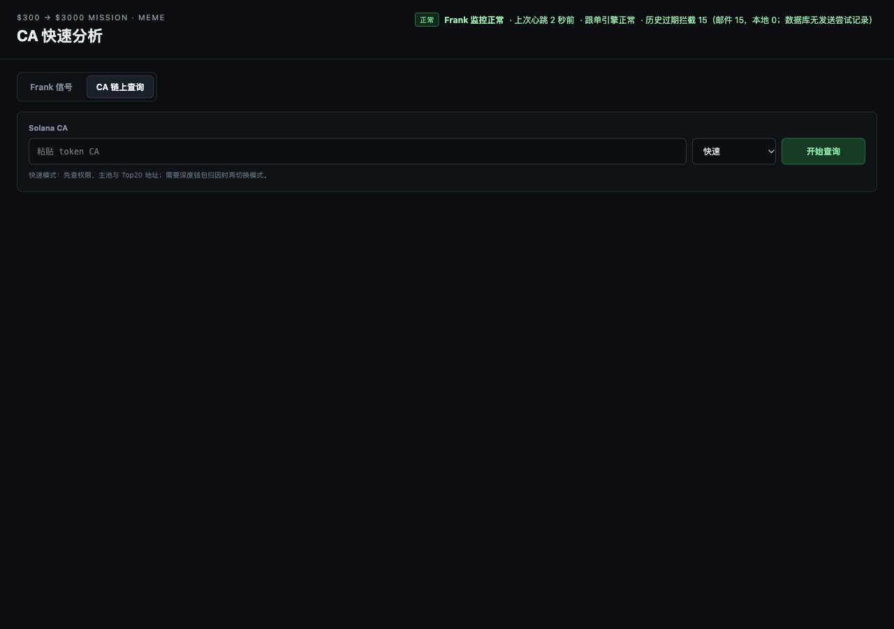

# PR #168 — PRODUCTION_DASHBOARD_PASS

真实 Mac Dashboard-only 生产切换，2026-10-23（Asia/Bangkok）。[用户正式授权](https://github.com/lxxlx2/ChatGPT_mission_record/pull/168#issuecomment-6362300375)。本报告是实际正式端口验收，不是此前 fixture 或模拟结果。

## 固定版本与构件

- 旧正式 Dashboard：`31dd598df248ca15f731913a5cbf82e88b981874`。
- 新实际安装版本：`656ed2c96f4210d106d7b1129ec6cf8d7c4586f3`。
- PR HEAD 在开始、构件组装前、原子切换前、完成后均读回固定新 SHA；PR 未合并。
- 独立 detached 临时 checkout；未切换/清理/修改原主工作区。
- 旧独立发布目录 **435/435 文件**与磁盘清单、旧 Git SHA 全部一致；规范化 manifest SHA256 `568c02201905377e83c4fd126ecb37fa02c6baa6f672b6ab62a40c80d155ff5a`。
- 新版本 **437/437 文件**与固定 Git SHA、安装目录完整匹配；新规范化 manifest SHA256 **`867ac626f5cec190d3c77621a3b0aaab6ed7fd30a8014367103c1adde01cd3ab`**。算法为 SHA256(json.dumps(filename_to_sha256, sort_keys=True).encode())，不是 tar SHA256。
- 安装相对支持根目录：`dashboard-only-releases/656ed2c96f4210d106d7b1129ec6cf8d7c4586f3`，新建目录，全部源文件/目录只读，原可执行位保留，规范化清单为只读同级文件。
- 现有专用 Python virtualenv 在新目录以 `-B` 成功导入真实 server/service/release approval 依赖，无安装依赖、无启动 worker。

Loop 旧共享目录保持原样。历史 PR39 内置清单列出148个受管文件：148/148 哈希一致；额外核对完整420个 Git 文件均与其固定 SHA一致，另有原 `.pr39-release-manifest.json`。最初审计将148误当全目录数量，已在任何 runner/服务变更前纠正为上述两个不同范围；没有为满足数量修改文件。

## 身份与保护服务

|服务|切换前 PID / 启动时间（+07）|切换后 PID / 启动时间（+07）|代码目录|
|---|---|---|---|
|Dashboard|69009 / 2026-10-22 21:58:09|**88897 / 2026-10-23 17:01:10**|独立旧31dd… → 独立新656ed…|
|MC Loop|36070 / 2026-10-13 17:32:13|36070 / 完全相同|原共享52d43…，未改变|
|Frank V1|80447 / 2026-10-23 07:44:52|80447 / 完全相同|原独立来源，未改变|

V1 今日 PID 与昨天部署报告不同；此次切换前已核实当前 PID、运行源文件、cwd、runner、plist、启动参数均正常，代码/配置与昨天私有留存一致。没有把昨日 PID 当当前事实，也没有因部署重启 V1。

切换前：V1 LIVE/OK，心跳年龄3.37秒；Loop OK 且新鲜。切换后：V1 LIVE/OK、consecutive_errors=0，最终心跳年龄25.68秒（正常30秒轮询范围）；Loop OK，updated_at `2026-10-23T10:02:22.313667+00:00`。V1/Loop PID、启动时间、代码目录、启动文件与 plist 未改变，V1 代码文件哈希未变。

13项原支持根/策略配置文件哈希、控制指针、V1/Loop policy_hash 均保持不变。Dashboard plist SHA256 仍为 `97fcfe41d5640bad85a5b0eadc5e4c9bac35bc28b67e53df649463a3c3fa9683`。

## 真实切换范围

1. 新增独立437文件只读构件和规范化清单，保留旧版。
2. 在私有700权限目录复制旧版完整435文件、原 Dashboard runner、plist、清单及保护文件哈希；全部回读一致，切换完成后再次验证旧副本完整。
3. 验证只替换 LOCAL_AGENT 行，反向替换能还原原 runner 的全部字节和模式。
4. 最后一次核对 GitHub HEAD、三项服务 PID/启动时间、8766唯一监听、保护文件及健康后，原子替换 dashboard.sh 中唯一 LOCAL_AGENT 路径。
5. 仅执行目标 label：

```sh
launchctl bootout gui/$(id -u)/com.jerson.frank-meme.dashboard
launchctl bootstrap gui/$(id -u) "$HOME/Library/LaunchAgents/com.jerson.frank-meme.dashboard.plist"
```

两个命令成功；中间读回目标服务不存在、旧PID不存在、8766无监听；未 kill 未知进程。未执行通用安装器、Loop/V1 管理命令。

现有生产配置文件实际修改：**dashboard.sh，一行 LOCAL_AGENT**。解释器、环境变量、PROD/CONTROL、端口和 plist 保持原状。

- 原 runner SHA256：`0b4af41dda31f2a45985019fdfec427a1bc74cb8d6ab44ddc1424949691f243a`
- 新 runner SHA256：`a7cf3df2308535a3de8f5b723a4a373eaece5f8ac54a2f7350db28e3adf3c4b0`

原 runner 会正常更新 Dashboard PID/port bookkeeping，原日志照常写入；这不被混写为生产数据库完全没有后台变化。其他原服务照常运行，未复制/冻结/直接写生产SQLite。

## 正式 HTTP 与 Chrome

**9/9 GET HTTP 200**：`/`、`/static/app.js`、`/static/styles.css`、`/api/runtime`、`/api/candidates`、`/api/trades`、`/api/frank-intelligence`、`/api/frank-activity-watch`、`/api/control-health`。首页/JS/CSS 返回字节与新安装目录完全相同；实际cwd和8766唯一监听者均为新Dashboard PID88897。详细状态/摘要见 http-sanitized.json。

真实 Chrome 155.0.8059.86，独立临时 profile，打开正式 `http://127.0.0.1:8766/#cluster`，CA 页面可见，输入框为空，没有默认订单金额；实际原始恢复按钮“继续读取原任务”“查看已有历史报告”存在。没有 pending 任务时恢复区域正常隐藏；未伪造生产任务使按钮显示，也没有用测试任务触发真实 CA POST。恢复按钮真实交互已在同 SHA 隔离 C/D/F 验收，此次不重复生产扫描或把“DOM存在”冒充生产任务恢复实测。

浏览器仅放行本地已知只读GET，其他方法/外部请求拒绝。读取14个页面/静态/API GET，无 CA analysis/latest 请求、无POST。浏览器 console error/pageerror **0**。14次 Chrome 后台连接意图经本地 deny-only proxy 拒绝，没有转发外网。临时浏览器和代理关闭、profile 删除。



## 通知、策略与权限

|指标|切换前 → 后|
|---|---|
|V1 gmail_sent_verified|2 → 2|
|V1 sent_unverified / pending / failed / blocked / local_pending|全部0 → 0|
|MC 历史 expired-unsent review|15 → 15|
|MC actionable / pending|0 → 0|

所有渠道细分计数也相同，见 after-sanitized.json；原 outbox 未释放，没有发送接口/测试Gmail/通知重放调用。没有更改买入信号、默认金额、策略、钱包、密钥、签名、交易、定时任务或数据库结构。发布操作真实 CA POST=0、额外RPC=0、通知调用=0、交易=0。原后台服务正常链上轮询不被宣称全局RPC停止。

## 中断、恢复和最终状态

- runner原子替换：2026-10-23T17:01:04.237338+07:00
- 旧Dashboard缺席/端口空确认：2026-10-23T17:01:10.477892+07:00
- 九项HTTP全部通过：2026-10-23T17:01:23.629488+07:00
- 缺席确认到HTTP检查完成：**13.152秒**；runner替换到检查完成：**19.392秒**。这是实际观察边界，不是连续采样所得精确断网时长。

短暂中断符合授权。**未发生上线验收失败，未执行回滚**。旧版目录/manifest与私有回滚包已校验可用；不声称实际生产回滚已演练。新旧完整安装清单在启动后再次一致。

最终 **PRODUCTION_DASHBOARD_PASS**。仅完成固定SHA的Dashboard-only切换；不是完整CA链上准确性、全钱包余额或完整业务Gate通过。PR仍未合并。发布证据后停止，不扩大检查或执行其他生产操作。

上传内容仅为脱敏摘要、公开文件名清单和无地址截图；原始API返回、生产DB、完整私有配置、凭据、地址与回滚包未上传。
