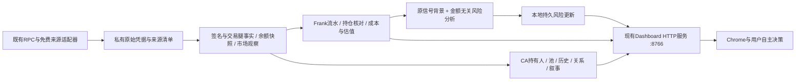

# Frank 整体功能技术方案与实施合同 v1

状态：READY_FOR_IMPLEMENTATION；2026-11-15；用户已授权免费本地研发、隔离实测、完成后本地部署，免独立 review。本方案固定实施范围，不代表功能已经完成或验收通过。

开发分支：`codex/frank-functional-completion-20261115`；唯一功能 PR：[#253](https://github.com/lxxlx2/ChatGPT_mission_record/pull/253)。规划前 HEAD：`f174b7f4ac0bfbf8304e7a60ca42869f5ed4b56c`；产品基线：`ee81a0f44c27eb539c3c874963d311d4e4d5761f`；已验证流水源码：`7bc564b074aa1fe87d809883d0d1364194a92562`。运行身份必须分别记录 Dashboard 与 Scanner，不能用一个 SHA 代表两者。

本文件定义设计决策；[执行清单](implementation-plan-v1.json)定义工作包、依赖和59项需求的验收映射；[接口合同](interface-contracts-v1.json)定义每个现有/拟增入口及请求、返回、错误和副作用。唯一动态进度仍为 [STATUS](../../crypto-300-profit-mission/meme/STATUS.md)。[现状审计](REQUIREMENTS_AND_GAPS_20261115.md)保留基线事实，不把计划改写成已实现。

## 1. 产品目标、用户路径与交付定义

Frank 是面向用户决策的钱包行为观察与代币尽调工具。用户需要知道 Frank 实际做了什么、现在持有什么、行为是否变化、当前行情与已核实买入相比怎样，以及输入任意受支持 Solana CA 时的身份、市场、持有人、池、风险、关系、叙事与来源。ACCUMULATION/MULTIPLE/HFT 等原规则提供事实背景；模型不承诺跟单盈利。

三条完整路径必须连通：

1. **Frank 观察**：签名/全部交易腿 → 可筛选完整索引流水 → 新鲜全钱包余额 → 模型与链余额差异 → 收藏备注 → 成本覆盖与估值 → 金额无关行为/风险更新。
2. **单次 CA 尽调**：exact CA 验证 → 元数据/权限/Token-2022 → 持有人和特殊身份 → 池与市场 → 重要持有人取得/买入/资金关系 → 有出处的叙事和独立认领状态 → 分项完整度、来源、耗时及可恢复报告。
3. **可用本地交付**：固定源码 → 隔离回归与多真实样本 → 统一功能验收 → 同一 8766 端口本地安装 → Chrome 实际操作 → 运行身份与回退验证。

完成定义是这些路径的输入、计算、存储、错误恢复和来源证据全部可用。测试数、提交数、单 CA 的 DONE、未知分类数减少，均不作为产品完成率。功能不支持或来源不足时必须返回可理解的缺项和来源状态；不能把合法未知当作已证明，也不能用未知状态掩盖本来可以补齐的代码缺陷。

保留前次范围：页面布局、样式、导航和视觉文案改版不在本轮。已有页面需要的数据接口和语义在本轮；统一验收仍须用 Chrome 检查已有路径是否真实消费新数据。如新功能暂时没有页面入口，必须如实列为 API 已实现/页面不可操作，不能冒充整体 Chrome 验收完成，后续仅做接通已有操作所需的最小绑定。

多人物、多链产品和已停止收益研究的延期依据见59项映射；本轮不批量恢复旧 Sidecar，不修改冻结信号阈值。通知模块可以完成持久性和隔离 fake 验收，实际发送、用户签名、交易和 Loop 启动不在本轮执行中。无新增守护进程、计划任务或端口；不合并主分支。原10月故障归因已取消。

## 2. 已核实起点与问题排序

| 事实 | 对设计的影响 |
|---|---|
| 分支调查305个远端HEAD、244个PR、83目录树/71非前端源码配置组合 | 选择性复用；未合并不等于未实现，旧模块缺席不等于应整栈恢复 |
| 运行版30天/all流水400；新分支已修复，并在8697签名/197交易行/76交易Mint副本对账 | 保留新分页合同，完整索引不是全链历史；旧1/7天响应兼容 |
| D2当前为11月1日4898账户历史工件，观察列表仍可能回退10月11日32Mint | 第一实施主项为真正的双程序钱包刷新；历史工件不得作为新鲜余额兜底 |
| 智能分析4条均PRICE_UNAVAILABLE，服务传入market_observations=None | 接已有免费市场读取；核实币对、币种和时间后才能比较，不直接把USD当USDC |
| 保存12份CA报告只有CRAWL；一次46分28秒主要为暖缓存 | 建立不同CA/协议/规模矩阵；冷/暖分别测量，不能对同一个CA反复全扫当功能开发 |
| CRAWL一次查询双源getMultiple耗时35分31秒，占76.44% | 先做方法/提供方能力探测、连接复用、分块流水线和缓存验证；不能靠少查账户提速 |

顺序按数据依赖确定：共同来源合同 → 新鲜持仓 → 行情与观察 → 事实纠错/成本 → 持久风险更新；CA通用性和性能在共享合同落地后独立推进。每个工作包有小范围回归；全部实现后做一次统一集成验收，不把最终测试留成唯一发现错误的机会。

## 3. 架构与复用边界

| 模块 | 复用/最小改动 | 必须保持的边界 |
|---|---|---|
| 来源与事实 | `frank/rpc.py`、`signals/scanner.py`、`signals/store.py`、`frank/archive.py` | Scanner原库只读；源码修复先隔离回放，本轮不重启运行Scanner |
| 流水 | `mission_control/wallet_activity.py`、`wallet_activity_paging.py`、`frank_activity_watch.py` | 同一事实投影，多腿不丢失；100条摘要不能冒充全部流水 |
| 持仓 | `wallet_owner_at_slot.py`、`wallet_inventory.py`、`wallet_reconciliation.py`、`wallet_d2_ingress.py` | 复用验证投影；新增全Owner刷新，不沿用旧冻结32Mint目标范围 |
| 行情与分析 | `meme/market.py`、`pool_market.py`、`market_parity.py`、`mission_control/intelligence.py` | 参考价、交易时原币成本和即时执行报价分别建模；不设默认金额 |
| 用户元数据与衍生账本 | 扩展现有control-root自有SQLite，新增小型repository函数 | 不写Frank源库；不将收藏/备注误作链上事实；GET不写入事件 |
| CA | `meme/cluster.py`及holder_ranks/special_roles/pool_* / historical_accounts / narrative / independent_check | 各阶段独立完整度；查询完成与证据完整分离；未知不能自动合并为关联控盘 |
| job与缓存 | `ClusterJobManager`、`JobCheckpoint`、现有RPC cache | 原始请求参数、来源指纹、解析版本和恢复绑定；续跑不能混合成原子快照 |
| 通知 | `signals/delivery.py`、`mission_control/delivery.py`、现有审计/策略 | V1身份不变；Option3风险更新独立；fake验收绝不调用真sender |
| 服务 | `mission_control/server.py`原进程与8766端口 | 同源和Host保护；异步作业复用进程内执行器，无新监听器 |

拟增小模块以职责命名：`source_evidence.py`、`wallet_refresh.py`、`market_observations.py`、`watch_metadata.py`、`cost_ledger.py`、`intelligence_store.py`。实现时允许合并职责相同的小文件；公共合同和验收ID不可默默变更。各模块接收注入的clock/transport/repository，离线测试无网络；生产来源只读，衍生结果写control-root。

## 4. 共同数据合同与准确性

### 4.1 每个事实的身份与来源

新数据对象使用 `schema_version`、`entity_id`、`chain`、`mint/wallet`、`source_ref`、`parser_version`、`code_sha`。`source_ref`至少包含：脱敏provider_id、method、规范请求参数hash、response_sha256、observed_at、事件/slot/commitment（来源支持时）、私有凭据引用。不同源响应分别保留，不能仅给合并JSON一个自证hash。

公共接口只暴露脱敏的来源ID与hash，不暴露认证URL、key、原始凭据正文或私有路径。原件私有不可变保存；解析纠错通过 `supersedes_id`、`superseded_reason` 和新版本追加，旧事实仍可追溯。格式校验/内容hash不代表来源可信，信任来自实际适配器、捕获链与可回放原始响应。

金额必须是十进制字符串：`raw_amount`为整数串，`decimals`为整数，`ui_amount`由二者导出；价格、费用、USD/USDC价值也用Decimal字符串，禁止float累计。签名可含多腿，腿ID包含wallet/signature/leg_index/parser_version；同签名不同Mint不能相互覆盖。

### 4.2 时间与完整度

分别记录 `event_at`、`first_indexed_at`、`observed_at`、`received_at`、`parsed_at`、`report_created_at`、`served_at`、`expires_at`。GET重新读取和缓存命中只改变served_at，不能刷新来源年龄。未来事件/未来行情不得进入回溯分析。

完整度是结构化维度：`scope`、`enumeration_status`、`history_status`、`classification_status`、`parity_status`、`missing_items`、`stop_reason`。通用值为 COMPLETE_WITHIN_SCOPE / PARTIAL / UNAVAILABLE / NOT_SUPPORTED / NOT_REQUESTED；旧接口既有状态保留，通过新字段补充，不能直接替换破坏兼容。

- `LOCAL_INDEX_ONLY`只承诺已索引集合；分页读完不声称全链。
- 两个Token Program均完整返回，只证明该Owner在各自slot的开放账户；不证明全部关闭账户、原子same-slot或终身历史。
- 地址历史空页只证明该地址在该提供方可查询窗口结束；记录provider保留范围，不能推出钱包终身首买。
- 二源读取同一批主源地址仅为数值核对；必须独立枚举且集合口径匹配才可标独立发现。不同slot只标跨slot比较，变化量不当作算法错误。
- job状态和数据完整度独立：DONE可含PARTIAL，必须列出缺项；ERROR/PAUSED保留已验证阶段且不能发布完整结论。

### 4.3 来源失败与有效期

来源失败返回null及error，不返回余额0、持有人0、无风险或无交易。旧快照可查但标STALE_ARCHIVED；最近成功快照与失败刷新记录分别返回，不能把旧值重新标新鲜。

持仓freshness初始沿用已有F02的300秒语义；行情参考的max_age_seconds由配置显式提供，初版60秒用于展示参考（不构成成交或下单时效承诺）。过期只失去“当前”资格，历史仍可读取。报价TTL复用现有明确报价合同，不复用参考价TTL。统一响应返回实际age、max_age、policy_hash。改变这些值需要可审计配置与测量依据，不是减少数据或限制预算的工具。

## 5. 来源方案、免费约束和容量

| 数据 | 既有来源/适配器 | 能证明 | 失败/不能证明的处理 |
|---|---|---|---|
| 钱包签名/交易/余额/Mint/程序账户 | 已配置私有RPC及现有RPC回退适配器 | 实际响应内的链事实、上下文slot、权限和账户余额 | 429按Retry-After/冷却，403保留安全码与能力状态；不循环重试永久拒绝；游标不前移 |
| 独立链核对 | 现有PublicNode secondary及independent_check | 分项数值比较；能力允许时独立集合枚举 | 每方法记录可用性，不用第二域名冒充独立上游；不可用保留阻断 |
| 市场与池对照 | DexScreener、GeckoTerminal、链上已支持池布局 | exact链/CA/池的市场观察和储备 | USD/USDC区分；第三方MC/FDV注明计算或提供方定义；无币对为未覆盖 |
| 身份/叙事 | 链上metadata/创建交易、既有metadata URI、项目网站和公开帖子读取 | 来源明确的角色、事件、文本与链接关系 | 原帖作者/互动/引用分别标；同名、转推、创建者链接不能当官方认领 |
| 即时报价 | 现有Jupiter适配器，且已有免费可用配置时 | 用户明确金额对应的临时报价 | 缺配置或额度时NOT_AVAILABLE，不建key、不升级、不代签、不广播 |

不新增任意总请求、总时长、总页数、Owner数或账户数上限来结束查询。不购买额度；不默默增加来源或替换数据口径。每请求超时、提供方真实batch上限、HTTP响应容量和本地磁盘保护保留并说明。分页/分块必须可继续取完，内存队列容量只控制同时在途工作。

来源能力记录同时保存 `access_mode/free_access_verified_at/cost_basis`，仅使用无需新增付费的既有访问方式；不启用按量扣费回退、试用转付费或升级。免费资格无法从现有配置/已有账户事实确定时列来源条件，不把“已有私有RPC”直接等同无限免费。

性能实施先记录 `provider_id + method → max_batch/encoding/minContextSlot/retention/observed_rate_limit` 能力凭据，随后连接复用、去重、可恢复缓存、按实际容量分块和自适应在途并发。遇429降低并发/冷却，403停止该被拒方法并保留已验证部分；不靠丢数据完成。没有免费来源可提供的历史或独立发现能力时，提交可复核原因；这是数据阻断，不能用工程技巧编造证明。

## 6. 业务对象与存储设计

既有 `forward.sqlite`仅只读。既有`mission-control.sqlite`保存通知/决策，不把新增功能写入旧outbox。新派生表采用前缀避免碰撞，使用显式版本迁移、单事务、WAL、FULL和唯一约束；在隔离副本验证迁移重入、回退旧程序与新表共存。私有快照原件与CA checkpoint继续放control-root既有私有目录。

| 表/对象（拟增） | 主键/唯一约束 | 主要字段与责任 |
|---|---|---|
| `frank_refresh_jobs` | refresh_id；active key(wallet,source_binding)；idempotency key+request_hash | QUEUED/RUNNING/DONE/PARTIAL/ERROR；阶段、脱敏错误、原始凭据、resume；接受202前持久化 |
| `frank_balance_snapshots` | snapshot_id；唯一manifest_hash | wallet、两个program的slot/hash/数量、capture起止、完整度、expires_at；只在验证成功后切latest指针 |
| `frank_market_observations` | observation_id；source_ref+mint+pair+observed_at | quote_currency、reference_price、source_time、age、coverage；失败与旧成功并存 |
| `frank_watch_metadata` | person_id+chain+mint；revision | pinned、note、watch_override、updated_at；与链事实分开 |
| `frank_watch_metadata_events` | event_id；唯一idempotency_key | before/after/revision/request_hash；追加审计，冲突409；删除备注也保留审计 |
| `frank_fact_revisions` | fact_id；wallet+signature+leg_index+parser_version | 解析事实、依据、supersedes；旧源库不改；原规则不被新解析回写 |
| `frank_cost_runs/lots/movements` | run_id与稳定movement_id；unique(input_manifest,accounting_version) | FIFO原币成本、费用/租金/转移、未知成本数量、covered PnL；输入与算法固定，可重算 |
| `frank_intelligence_runs/updates` | run_id；unique(entity,semantic_hash,analysis_version) | source_signal_id、余额/市场/成本引用、风险kind、前一状态、缺项；本地持久更新，无sender调用 |
| `frank_intelligence_outbox/attempts` | update_id+channel+policy_hash；attempt_id | 独立于V1的风险投递合同，delivery_mode=FAKE_ONLY、真实通道disabled；持久attempt/结果未知/receipt/reconciliation，不能只用内存seen |
| `frank_notification_annotations` | notification_id+channel；revision | archived_at/reason及审计；不得改变旧delivery status、receipt或expiry，不重新enqueue |

原始数据不在公共仓库。新API使用不可猜的job ID不是认证机制，同源/loopback保护仍必需。摘要不带RPC URL；异常必须转换白名单错误码。写请求做幂等键和请求hash绑定；相同键不同body返回409。恢复只沿固定source/code/parser绑定继续，不匹配时创建新版本并保留父引用。

## 7. 接口与模块实现合同

完整机器可读合同见[interface-contracts-v1.json](interface-contracts-v1.json)。标为PROPOSED的接口本次尚不存在；不得在文档示例中当作已提供。新接口采用 `schema_version/status/as_of/data/coverage/sources/errors` 包络；既有接口保持原响应并追加字段。业务未知为成功响应里的null及coverage，语法/版本/来源不可达错误使用明确HTTP码；原路径遗留200+UNAVAILABLE保持兼容。

新写接口仅允许同源loopback，校验Host、精确同源Origin、JSON和请求体大小；CSRF保护不能仅接受任意localhost不同端口。拒绝未知参数、重复参数和非有限数值；状态写入只改control-root。GET不启动RPC、job、行情刷新、ledger重算、通知或更新写入。

### 7.1 完整流水与事实

保留 `GET /api/frank-signed-activity?days=1|7|30|all`；加`limit/cursor/kind/mint`为已有候选实现，limit只控制每页1–1000条。默认旧1/7天完整响应不变。游标固定截止、过滤、来源文件身份、初始rowid上界；已有源行可更新，因此不是不可变快照，保留这一兼容合同。用于复核/成本的严格读取选择物化版本：`POST /api/frank-evidence-manifests {kind,idempotency_key}`在一致只读事务内生成不可变规范行集合，`GET /api/frank-evidence-manifests?manifest_id=`读取状态和引用，`GET /api/frank-evidence-activity?manifest_id=&cursor=`只读该固定版本。源行后续更新不会改变既有manifest；新纠错创建新manifest/supersedes，不能默默变更旧版本。大集合分块持久化但完成前不标可用，验证计数/hash后原子发布。

实施澄清（2026-11-17）：纯本地 `activity|facts` manifest 使用同步 `201 COMPLETE`，在一致源快照、全部规范行及哈希落地后原子发布，不额外创建202后台任务。`positions|market` 类型尚未实现，不能伪称支持。固定规范行同时携带未解释的 `raw_trade_legs`，保留重复腿的原始行身份；这不替代新多腿分类、费用/租金归因和supersedes合同。GET及重载不创建快照；POST失败不发布半成品。

新 `GET /api/frank-coverage` 返回indexed最早/最新、已知缺页/解析未决、Scanner观察时间和原始来源引用，不用heartbeat推出零漏扫。多腿投影保留每腿、被动收付/失败/ATA/未知和counterparty，Mint过滤只按钱包自有余额变化与已核实交易腿。

内部合同：`read_activity_page(query, cursor) -> ActivityPage`；`classify_evidence(tx, wallet, parser_version) -> FactRevision[]`；`coverage_for_wallet(wallet, as_of) -> Coverage`。重复签名不重复事实，同签名重解析必须有supersedes；不重算或修改冻结信号。

### 7.2 新鲜钱包刷新与持仓核对

`POST /api/frank-balance-refresh`传`{idempotency_key}`，wallet从已有Frank配置获取，不能借此启用任意新钱包。202返回refresh_id。`GET /api/frank-balance-refresh?refresh_id=...`只读进度；`POST /api/frank-balance-refresh/resume`传`{refresh_id,idempotency_key}`。重复提交共用在途同wallet+source任务，键冲突409。

执行 `getTokenAccountsByOwner` 分别读取SPL Token与Token-2022，finalized，第二个请求继承前一个minContextSlot；验证完整数组、owner/mint/program、整数、重复账户和响应上下文。必要分块读取元数据不得丢失账户；SOL原生余额另列，WSOL为Token账户避免重复计算。两个program不同slot必须保留两个slot，不能标原子快照。

部分失败保留部分进度和原件，不更新“完整快照”的latest指针；恢复时重新验证旧阶段有效期，若已过期重新捕获两程序，旧结果留档。`GET /api/frank-positions?cursor=&limit=&mint=&snapshot_id=`返回snapshot绑定的全Mint聚合、非零/零/来源不明、model state、reconciliation、source_age与覆盖；分页全集可达。原`/api/frank-d2-at-slot`继续支持历史工件和专用头，不当作实时通道。

内部合同：`capture_owner(wallet, rpc, clock) -> BalanceSnapshot`；`validate_snapshot(raw_manifest) -> VerifiedSnapshot`；`reconcile_positions(snapshot, model_facts) -> Position[]`。余额不同仅表示差异，不能无依据归因为卖出/买入。来源失败、零余额、未发现账户、关闭账户必须分开。

### 7.3 行情、估值、成本与风险分析

`POST /api/frank-market-refresh`请求`{scope:'observed'|'positions'|'mint',mint?,idempotency_key}`；observed/positions读取全部相关Mint并可分块完成，无前N个总截断。202及job GET沿用共同作业合同。`GET /api/frank-market-observations?mint=&cursor=&limit=`只读已捕获市场事实。

参考价对象包含chain/mint/pair/base/quote、source、currency、price、observed_at/expires_at、可验证pool来源。现有Dex客户端仅选baseToken的方向和最多8池需修正为完整候选、明确方向和全池覆盖；反向报价只在可验证换算时支持。Dex USD不能塞进分析函数USDC字段；分别比较同币种或接入有来源的汇率。相对买价只有event-time原币对价/费用口径可验证时计算；当前SOL价不可回填历史USD成本。

`POST /api/frank-cost-rebuild`在固定事实manifest上重建账本；`GET /api/frank-cost-basis?mint=&run_id=&cursor=`返回lot、成本覆盖、原币已实现/未实现PnL、fees/rent单列和未知成本余额。FIFO为初版明确会计方法，不声称税务依据。钱包内ATA迁移保持成本；来源不明转入保留unknown lot；归属不明的费用不均摊成已证事实。部分成本只能输出covered_quantity对应的partial PnL，整仓PnL为null；无价格的资产不计作0价值，同时返回已估值/未估值数量与Mint清单。

`POST /api/frank-intelligence-refresh`显式计算并持久化；现有`GET /api/frank-intelligence`仍可纯只读预览，新增`GET /api/frank-intelligence-updates?cursor=&limit=&mint=&kind=`读持久更新。分析函数只接受注入的来源事实、余额和市场时间；源BUY/SELL、当前参考、真实可执行资格分别输出。相同semantic_hash不重复更新；新SELL/减仓、来源变旧、关键风险、重新买入等才形成可追溯的新kind。GET和进程重启不能让旧事件复活。

`POST /api/frank-quote`只在明确`{mint,input_mint,input_amount_raw,slippage_bps}`时调用已有quote适配器；返回quote_id/input/route/source_time/expires_at，永不发送交易。不提供默认金额；金额未给时400，source无免费配置时503；GET分析/持仓/CA不自动调用此接口。

### 7.4 持久观察与通知审计

新`PATCH /api/frank-watch-metadata/{mint}`传`{expected_revision,idempotency_key,pinned?,note?,watch_override?}`；GET按Mint/游标读取。字段长度是输入容量保护，不能隐藏观察对象；watch_override仅改变用户观察选择，不影响模型仓位或原通知阈值。revision冲突409，重试同键同body返回原结果。重启后保留；非法Mint/其他钱包/越权路径拒绝。

`POST /api/frank-notification-archive`只写归档注解；`GET /api/frank-notification-audit`可回查源事件、decision、outbox、attempt、receipt、archive及分段延迟。无法回读Sent时保留SENT_UNVERIFIED/UNKNOWN，不因重试发第二封。Option3本地风险更新表与V1 delivery身份分离，使用fake sender完成崩溃和模糊结果回归；本轮实际发送为0。

### 7.5 CA作业、分项报告和性能

复用`POST /api/cluster-analysis {mint,preset}`、`{resume_job_id,mint}`、`GET /api/cluster-analysis?job_id=`、`GET /api/cluster-latest?mint=&job_id=`及narrative supplement。改造以追加字段/阶段为主，接口非法CA400，job缺失404，来源/版本绑定不匹配409；GET恢复只读，POST才继续来源调用。报告按阶段发布已验证部分，必须带capture/code/parser/registry身份及missing/stop_reason。

1. **身份/权限**：exact32byte公钥、chain、mint owner program、metadata/创建交易；name/symbol同名不合并。Mint/freeze/update及Token-2022 transfer fee/hook、permanent delegate、default state、non-transferable等按真实布局解析；不认识扩展为NOT_SUPPORTED，有无权限与权限是否已撤销分开。
2. **持有人/角色/池**：全Mint账户枚举、整数Owner聚合、与supply及context核对。池/vault/LP/锁/CEX使用有出处的程序/地址注册，不从转账或名字推断。移除候选池前8和其他隐性总截断，逐页/分块处理全部发现池；未覆盖角色单列，不输出完整normalization。原始supply、流通/排除分母、Top10公式和每项排除清单均可复算。
3. **池经济**：6类已支持布局分别验证owner、discriminator、版本、base/quote、vault、fee/virtual reserves、LP或集中流动性锁定定义。集中流动性不能套用恒定乘积LP销毁率；未知协议显式隔离，不给低风险结论。原始reserve与经济调整值同时保留。
4. **历史/关系**：报告`history_scope`和选择规则，消除悄然Top20等总截断；先输出最有决策价值的物质持有人/关系阶段，其他继续可恢复。取得、转入、首个已见买入、地址来源结束、终身首买分开。关闭账户全集不明时不能证明终身首买。资金来源按SOL/WSOL/USDC原币与真实对价分析，复杂路由未决原样保留。关系边包含签名/账户/时点/类型/强度；共同funder和公共设施不能自动当同一控制人。
5. **叙事/认领**：必须保留可验证的主题、人物、事件、内容摘要、原帖/网站和时间；“未验证官方认领”不删除叙事。Musk等互动必须核实具体账号/原帖/互动类型，不能把转述当互动。认领字段独立为EXACT_CA_CLAIM_VERIFIED / LINK_ONLY / NO_VERIFIABLE_CLAIM / SOURCE_UNAVAILABLE。起源为最早可追溯证据，除非证据足够不得声称全网最早。遍历已链接来源和引用链时按visited去重，移除任意3源/3层/6帖总截断，保留网络/文档容量保护；爬取范围与未访问链接公开，不能无限扩展成全网爬虫。
6. **独立核对**：公开二源method能力及安全失败码；独立枚举失败时继续单列数值核对结果，不降格冒充独立集合成功。枚举集合、数字、池、市场分别有parity_status；大Mint核对全部账户，不能用抽样10条替代数万账户全量。
7. **性能**：各阶段记录wall time/monotonic、queue、cache hit/miss、wire数、bytes、retry/cooldown、batch size与account数。冷run使用独立空缓存；暖run明确复用范围。优化前后固定业务输入和口径逐项对账，结果集合/hash/unknown/coverage不得因提速缩水。CA身份、基本风险、市场及阶段报告先可读，深历史继续异步，不把“先看到部分”说成完整完成。

## 8. 错误、恢复、兼容与隐私

统一新错误码：INVALID_INPUT/INVALID_MINT(400)、SAME_ORIGIN_REQUIRED(403)、NOT_FOUND(404)、REVISION_CONFLICT/IDEMPOTENCY_CONFLICT/SOURCE_BINDING_CHANGED(409)、SOURCE_UNAVAILABLE(503)、RATE_LIMITED(503并附retry_after)、PARTIAL_SOURCE(200的coverage)、UNSUPPORTED_PROTOCOL(200的NOT_SUPPORTED)。500仅内部错误，公共正文不反射exception、URL或私有路径。旧接口错误码保留，adapter显式转换。

作业持久化在应答前；页/分块只有在原件和输出事务提交后才前移cursor。模拟进程终止点覆盖请求前、响应后写前、checkpoint后、latest指针切换前后。源库文件替换、schema/parser变更和源绑定变更必须拒绝旧游标/恢复，不能静默拼接。磁盘满、SQLite锁、malformed/truncatedJSON、重复页/签名、空页、provider拒绝均保留最后一致状态与可读错误。

新增GET不改变DB mtime/计数，不调用socket或sender；涉及刷新网络的行为只发生在显式POST/CLI。新写路径测试精确Origin、端口、Content-Type、body容量、未知字段、路径遍历、控制字符和Unicode；render前做内容转义。公共提交逐项扫描token、认证URL、私钥、email、私有路径与未脱敏raw；记录source fingerprint不暴露秘钥可逆信息。

## 9. 实施顺序与工作包

机器清单包含全部59个需求ID、工作包、接口和逐项验收；没有将“已实现机制”默认视为整体通过。

| 工作包 | 交付 | 前置 | 完成证据 |
|---|---|---|---|
| W00 | 现状/范围/技术方案/接口/59项映射 | 无 | 文档交叉核对；59/59映射；依赖无环；GitHub固定提交 |
| W01 | 30/all索引流水、分页/筛选/来源字段 | 已完成代码 | 161 Python/212 Node；8697签名/76Mint独立对账；未部署 |
| W02 | 共同来源/时间/覆盖/精度、查询与写保护 | W00 | 原始hash回放、未来时间/错CA/非有限数/泄漏反例 |
| W03 | 双程序全钱包刷新、恢复、全持仓核对API | W02 | 非32Mint全Owner；完整/单程序失败/零余额/多账户；真实来源捕获 |
| W04 | 免费行情接线、同币种参考与完整估值范围 | W02,W03 | 多Mint有价/无价/错币对/过期/USD≠USDC；不调Jupiter |
| W05 | 收藏/备注/观察变更及审计 | W02 | 幂等/冲突/重启/源库不变；全部观察对象可达 |
| W06 | 多腿、费用租金、版本纠错与历史覆盖 | W01,W02 | 多真实签名+协议复杂路由；主动/被动/失败/ATA/未知分离 |
| W07 | 原币FIFO成本、转移、部分PnL和估值 | W03,W04,W06 | 独立算例/真实多Mint；unknown不置零；差额可解释 |
| W08 | 金额无关分析与持久风险更新、显式报价 | W04,W05,W06 | 真实多情景+fake时钟；重启不重复；默认金额/真发送为0 |
| W09 | CA身份/Token-2022/全持有/全部池/角色 | W02 | 不同生命周期/程序/池布局；全量集合和分母可复算 |
| W10 | CA历史/资金/关系证据和范围 | W06,W09 | 真实复杂/反向/无关设施样本；未决原因逐条保留 |
| W11 | 叙事/人物事件、认领与可追溯起源 | W02,W09 | 有互动/无互动、真假认领、同名异CA、来源失败均正确 |
| W12 | 免费二源能力、数值/集合核对、冷暖性能 | W09,W10,W11 | 所有功能不截断；同输入前后对账；冷暖分列；部分报告与恢复 |
| W13 | 通知审计/归档/分段延迟与fake可靠性 | W02,W08 | 原V1身份不变、模糊发送不盲重发、风险不借旧策略 |
| W14 | 多场景统一测试、本地部署、Chrome与回退 | W01,W03–W13 | 逐场景证据，固定产品/Scanner SHA，8766，运行/回退记录 |

同一工作包内优先修影响主路径的真实缺陷，再补未覆盖反例。每次完成更新STATUS及对应证据ID；遇外部访问拒绝保留方法/次数/安全码/时间，并推进不依赖它的工作，不能无意义重扫同CA。不存在免review之外的新增批准步骤。

## 10. 统一验收设计

各场景在执行前固定`case_id、选择理由、chain/CA或wallet、来源、代码SHA、capture时间/slot、预期能力、独立对照方法`，执行后记录命令/返回/完整度/性能/原始hash。真实CA应从已有免费来源中选择并核实身份；目前没有新增真实样本被宣称已选中或已通过。

| 验收ID | 必测场景 | 断言 |
|---|---|---|
| E01 | 既有真实多Mint索引，24h/7d/30d/all，BUY/SELL/被动/失败/ATA/未知 | 与独立源SQL/原件集合对账，所有页无丢重复；反例含同时间、回填和源替换 |
| E02 | 实际Frank全Owner开放账户，两Token Program，零/非零/多ATA/无行情 | 新鲜完整快照、非32Mint限制；sum整数准确；跨slot如实；错误不变零 |
| E03 | 新鲜/过期/未来/无价/错误链或CA/不同报价币种 | 不比较异币价格；portfolio覆盖分母明确；GET不刷新时钟 |
| E04 | 收藏备注/退出再入/并发revision/重启 | 状态持久且不影响原信号；全部观察对象可读 |
| E05 | 多腿/路由/被动空投/内部ATA迁移/失败/手续费租金 | 动作与成本分离；未知保留；纠错可追溯；不凭余额净变化断言买卖 |
| E06 | 多次买卖FIFO、部分退出、未知转入、无价格资产 | 独立原币精确算例与真实输入核对；partial PnL不冒充整仓PnL |
| E07 | ACC/MULT/再入/减仓/SELL/陈旧来源/新风险/数据不足混合 | 沿用Option3原代表情景要求；源BUY不被无金额或WAIT吞掉；持久去重和版本更新 |
| E08 | 近期Pump毕业、成熟、LP-heavy、Token-2022风险、疑似关联及无关对照 | 使用不同真实CA覆盖这些场景；不能全用CRAWL。每个场景保留来源和成功/失败 |
| E09 | PumpSwap、Raydium CPMM/AMMv4/CLMM、Orca Whirlpool、Meteora DLMM | 每个已声称支持布局均有真实字节/元数据/池对照；未知版本不假设通过 |
| E10 | 小/中/大型Mint，全账户/Owner、供给、特殊身份、全池 | 大小由实际账户数与分布报告，不硬编规模标签；完整集合/分母/角色缺项可重算 |
| E11 | 原帖人物互动与无互动、官方exact CA认领/仅链接/无法核实 | 叙事有内容和出处，认领独立；最早可追溯不冒充全网起源 |
| E12 | 二源可用/429/403/不同slot/集合缺失或余额变化 | 独立枚举和数值比较分开；错误捕获脱敏且不填0；提供方可用性按实测 |
| E13 | 冷首次/暖复查、断网/终止后resume、磁盘失败 | 输出集合与完整度不缩水；阶段可读，恢复不重扫已验证部分且不混旧时间 |
| E14 | 原V1+Option3 fake发送、超时后结果未知、重启、过期和归档 | 无重复通知；unknown不标Sent；旧通知不复活；真实发送0 |
| E15 | 固定候选本地安装与Chrome真实交互 | 8766已有入口、实际请求/页面状态和运行SHA一致；刷新/筛选/续页/恢复可用；回退可运行 |

执行层次明确分开：合成与故障注入 → 私有真实捕获离线回放 → 实际免费来源只读 → Mac HTTP/Chrome → 本地安装效果。某层NOT_RUN不能借另一层补PASS。现有161/212与8697/76证据仅覆盖W01，不覆盖新规划或多CA。

性能不先编造“几秒完成完整历史”的承诺。统一验收记录到身份/风险首份可读时间、各阶段时间、完整报告时间、全部数据量、冷暖cache、wire/bytes/重试与瓶颈；优化比较同条件原始输入和独立重算结果。若完整深历史仍需长时间，必须给出可用阶段结果与恢复进度，并将实际耗时作为产品剩余问题；不能因为异步返回202就判性能完成。

验收证据条目必须含 `requirement_ids / scenario_id / code_sha / command / environment / source_manifest_hash / input_count / output_count / started_at / finished_at / result / actual_errors / remaining_blockers`，并将离线/实源/Chrome分别列。公共证据仅含脱敏摘要与hash，私有原始材料保留可复算引用；任何一个必测场景未执行都不能由其他场景的成功自动补齐。

## 11. 发布、回退与剩余真实阻断

完成W14前不把当前ee81运行版写成已升级。统一测试通过后按已有授权安装当前固定候选到独立release目录；校验源码manifest、进程工作目录、实际API中的code_sha与静态资源版本，继续使用8766。只维护Dashboard，不顺带启动Scanner/Loop或修改其源数据库。回退使用保留旧release与自有DB一致备份，在隔离副本实际验证可运行；失败保留首错、恢复旧Dashboard并给证据。

最终结论分别列：功能接口/离线真实回放/实时来源/Chrome本地/通知真实投递/全链历史/策略收益。主线产品PASS要求所有in-scope工作包有证据且没有关键路径缺失；外部不可得数据可在产品内准确展示UNKNOWN/PARTIAL，但不能把对应“完整历史/独立发现/官方认领”验证标PASS。因真实来源拒绝或缺失凭据无法达到目标时列数据阻断、已尝试证据与最小用户决策，不反复追加权限问题或伪造结果。

当前真实风险为免费来源方法可用性/历史保留、独立枚举与跨slot一致性、复杂交易及关闭账户、部分协议/扩展布局、来源可验证叙事范围、深历史耗时。它们需要在实现与代表矩阵中逐项证实；计划把风险转成接口字段、工作包和测试，不声称写完计划就消失。

## 12. 历史要求与截图反例防遗漏映射

以下ID来自固定旧TODO，不能只因换了59项编号就消失。按后续G1和用户指令处理冲突；视觉展示条目不扩展成页面改版，底层数据正确性仍验收。

| 旧项 | 本轮映射与处理 |
|---|---|
| A00 / S01–S03 | RL04/RL07、W00/W13/W14：当前分支/运行身份、旧研究安全缺陷逐项择取；不整栈合并、不启动Loop |
| A01 / 原12条截图 | E01–E15：冻结已可定位的真实反例与预期；Agency exact CA/同名、GOMO分仓/公共fee-payer、NO_BUY+SELL+未知仓位、复杂成本/LP-heavy/首买/叙事保留；原10月故障归因单独取消 |
| A02/A03/A07 | DF01延期多人物启用；Frank入口明确注册身份且只读；错钱包/错链隔离测试仍属RL01 |
| A04 | SRC02–06/ACT05–06、W02/W06：原始凭据、多腿、幂等/纠错/覆盖复用；旧整套Sidecar不迁移 |
| A05 / F02 | POS01–04、W03：实际全Owner双程序及差异；32Mint仅历史回归，不限制新采集 |
| A06 / F03 | POS07–08/ACT01–06、W01/W04/W07：单Frank原币成本/估值/PnL/全范围流水；多人物聚合延期。至少5个重要Mint与可公开访问的GMGN/FOMO同窗口横向对照，标源时间与口径差异；不可访问保留失败，不用截图代替当前链证据 |
| A08 | SRC03/RL05：复用既有私有证据/脱敏导出保护，错误public/private目标、断线/重复hash/版本冲突fail closed；本轮不新增自动上传或默认公开钱包轨迹 |
| F01/F05 | INT01–05/SRC06/NT01、W06/W08/W13：源信号与执行资格分开；SELL优先于旧摘要事实；复杂金额不伪证，旧邮件/outbox hash不变 |
| F04 | POS05–06、W05：WATCH/HELD/EXITED/ARCHIVED/FOLLOW的模型/链/用户三种维度分开，持久收藏备注及完整检索 |
| C01/C09 | CA13、W09–W12：统一渐进尽调及分项完成门槛；API保留preset作兼容，不能形成快速档总截断。新增默认入口按同一完整来源流程执行 |
| C02/C03/C04 | CA01–06、W09/W12：identity/Token-2022/全部pool/受益Owner、raw与调整Top10/cluster-adjusted范围和分母；不得把关系组当控制组 |
| C05/C06 | CA07–09、W10：超过旧100/50/Top20边界的历史回归，真实分仓/公共设施反例；物质未知继续查可得证据，停止原因明确 |
| C07 | CA10–11、W11：至少3个不同真实CA有来源叙事或逐项完整合法检索失败；无认领不等于无叙事 |
| C08 | INT07/CA13、W08/W12：CA无默认30USDC询价；仅显式金额即时quote+TTL；不改变旧冻结V1引用 |
| C10 | CA12/14/15、W12/W14：五类不同真实CA、六协议、不同规模、跨源/冷暖/中断及对照；不强制付费GMGN |
| S04 | NT02/NT05/RL02–04、W13/W14：来源/恢复隔离证据与实际Gmail/launchctl另列；本轮不真发或启Loop，不把fake写成live |

原截图/公开对照若只有文字而没有可定位CA/签名/原件，标 `INPUT_NOT_RECOVERED`，优先从已有附件/证据恢复；不能编一个相似CA宣称修复了原例。与此同时用已核实的不同代表样本验证通用能力，避免原例缺失阻断所有开发。
